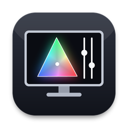

<div align="center">
  
  <h1>Display Tuner</h1>
  <p><strong>Research-based display settings for gaming and editing on the Mac.</strong></p>
  <p><a href="https://github.com/BireshwarChakravarty/DisplayTuner/releases/latest">Download Display Tuner 1.1</a> · <a href="DisplayTuner/README.md">Technical guide & research</a></p>
</div>

## What it does

Pick a display, choose what you're doing, review exactly what will change, and apply it, with your previous settings saved for Undo. It looks and works like a built-in Mac app.

- **Six presets:** Competitive Gaming, Immersive Gaming, Photo Editing, Video Editing, MacBook Look and Everyday. Each previews what it sets, for example "160 Hz · sRGB · 120 nits".
- **See your display:** a colour-gamut chart against sRGB and P3, and readouts for refresh rate, desktop size, colour mode and brightness.
- **Finds the free win:** if a screen runs slower than it can at the same resolution, it offers the fix in one click.
- **Changes shown before → after,** each with its reason and source.
- **A checklist for what only you can do:** monitor menu, System Settings, cable and app settings.
- **Asks your monitor what it supports** over DDC/CI, so hardware changes are only offered when the monitor lists them. On monitors that list an sRGB preset, editing switches it for you.
- **Automatic presets (optional):** games and photo/video editors switch your screens' preset when they come to the front.
- **Stay in control:** Undo, Restore Originals, a keep-or-revert countdown for resolution changes, calibration protection and recovery from interrupted changes.
- **Also:** saved presets, full-screen test patterns, a Control Center-style menu-bar panel (presets, live brightness, Night Shift), activity history and diagnostics export.

## Install

Download the ZIP from [Releases](https://github.com/BireshwarChakravarty/DisplayTuner/releases), unzip, and drag **Display Tuner.app** to Applications. Requires Apple Silicon and macOS 26 or later.

The community build is ad-hoc signed and not notarized. macOS may ask you to approve opening it under **System Settings → Privacy & Security**. Verify the download using the supplied SHA256SUMS.txt.

## Build

```sh
cd DisplayTuner
bash make-app.sh --package  # build a signed app and ZIP without installing
bash make-app.sh --install  # explicitly install and open the app
```

Build with an Xcode 26 SDK or later. The deployment target is macOS 26. The app icon is drawn by `scripts/make-icon.py` (Python with Pillow and NumPy), stored as a versioned base64 PNG, and turned into `AppIcon.icns` by the packaging script.

```sh
swift test --package-path DisplayTuner
python3 scripts/test-core-portable.py  # fallback when Command Line Tools lack XCTest
```

## Explore safely

```sh
open "DisplayTuner/.build/app/Display Tuner.app" --args --demo
```

Demo displays are clearly labeled. Hardware writes, saved presets and full-screen patterns are disabled in this mode.

## Keyboard shortcuts

| Shortcut | Action |
|---|---|
| ⌘1–⌘4 | Switch workspace sections |
| ⌘R | Rescan displays and DDC controls |
| ⌘Return | Apply the selected display’s tuning plan |
| ⌘Z | Undo last apply |
| ⇧⌘E | Export diagnostics |
| Esc | Revert an unconfirmed mode change / close a test pattern |

## Compatibility and privacy

Settings, presets and the last 100 operation results stay on your Mac. There is no analytics service or account requirement. DDC and Night Shift support depend on the hardware and private macOS APIs. Brightness and gamut figures are estimates, not calibration measurements. Calibrated displays keep their hardware levels and picture modes.

Read the [release notes](RELEASE_NOTES.md) and [technical guide](DisplayTuner/README.md) for limits, sources and monitor-specific advice.

## License

[MIT](LICENSE) · Copyright © 2026 Bireshwar Chakravarty.
